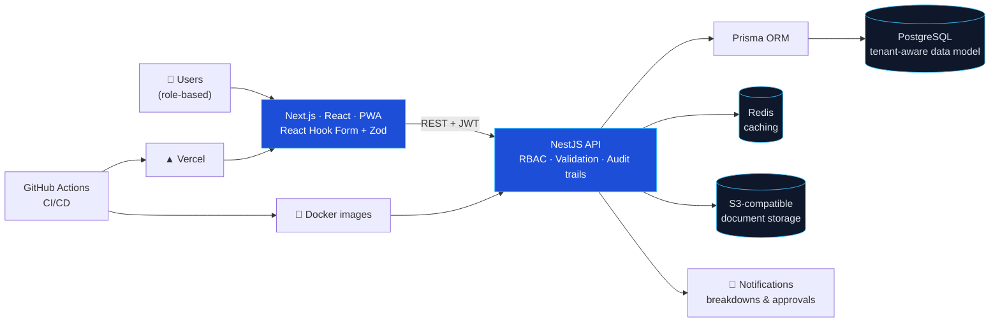

<!-- ═══════════════════════════════════════════════════════════════════
     Profile README · Yohannes Tibebu Mulugeta · github.com/ras3777
     Repo name must be exactly: ras3777/ras3777  (public, with this README.md)
     ═══════════════════════════════════════════════════════════════════ -->

<div align="center">


<a href="https://github.com/ras3777">
  
</a>

<br/>


<br/><br/>

<a href="https://www.linkedin.com/in/yohannes-tibebu-913039387"></a>
<a href="mailto:rasjohntibebu@gmail.com"></a>
<a href="https://github.com/ras3777"></a>

</div>

---

## 👋 About Me

I’m a **full-stack software engineer** building **workflow-driven business systems** since 2024 with **TypeScript, NestJS, Next.js and PostgreSQL**. I turn messy, paper-and-spreadsheet operations into reliable, auditable software, with role-based access, approval flows, notifications and reporting built in from day one.

```ts
const yohannes = {
  role: "Backend / Full-Stack Software Engineer",
  focus: ["Enterprise workflows", "CMMS", "ERP", "Multi-role platforms"],
  location: "Addis Ababa, Ethiopia 🇪🇹",
  education: "BSc Computer Science · Debre Birhan University (2025)",
  currently: [
    "Building a pilot CMMS for AHFA PLC",
    "Developing a modular SaaS ERP foundation",
  ],
  principles: ["RBAC by default", "Audit everything", "Ship it, then iterate"],
} as const;
```

---

## 📊 Impact at a Glance

<div align="center">

| 🌾 **100+** | 🧾 **~5,000** | 🏭 **1,000+** | 👥 **50+** |
|:---:|:---:|:---:|:---:|
| farms & organizations on a **live** production platform | livestock / genetics records digitized | work-order, PM & shift-handover transactions digitized | pilot participants across company staff & dev team |

</div>

---

## 🚀 Featured Work

<table>
<tr>
<td width="50%" valign="top">

### 🏭 AHFA PLC · Industrial Maintenance Platform (CMMS)
`Mar 2026 – Present` · Contract · *Internal pilot deployment*

Full-stack maintenance and operations platform replacing paper logs and spreadsheets.

- Digitized **1,000+** work-order, preventive-maintenance and shift-handover transactions
- **NestJS + Prisma + PostgreSQL** workflows for asset hierarchies, spare parts, utilities maintenance/handovers, **RBAC**, **audit trails** and **breakdown notifications**
- Repeatable **Docker** installation package with **Redis** caching and **S3-compatible** document storage
- Piloted with **50+** staff; early feedback: faster record retrieval, fewer duplicate entries, quicker breakdown notifications


</td>
<td width="50%" valign="top">

### 🐄 SGIP · Livestock Genetics Platform
`Aug 2024 – Jun 2025` · Freelance (Upwork) · *Live production · two contract phases*

Bovine genetics and livestock management platform for the whole ecosystem.

- Shipped a **live** platform for **100+** farms/organizations and **~5,000** records
- Role-specific workflows for **farmers, field agents, administrators and regulators**
- Regulatory search & reporting: secure **read-only** access, animal-record search, **CSV / Excel / PDF** exports, reducing reliance on manual farm visits


</td>
</tr>
<tr>
<td colspan="2" valign="top">

### 🧩 Modular SaaS ERP · Independent Product
`Mar 2026 – Present` · *In development*

A reusable ERP foundation covering **inventory / warehousing**, **assets / CMMS** and **configurable approval workflows**, with CI/CD via **GitHub Actions** (Docker build & delivery) and **Vercel** for the frontend. Backed by **Jest** integration tests for DTO/Zod validation and API behavior in a separate NestJS API project.


</td>
</tr>
</table>

---

## 🏗️ How I Build: Reference Architecture



---

## 🛠️ Tech Stack

<div align="center">

**Backend & Data**


**Frontend**


**Testing & Delivery**


**Security & Systems**


</div>

---

## ✍️ Latest Posts

<!-- BLOG-POST-LIST:START -->
*Technical write-ups on workflow-driven systems, NestJS and PostgreSQL are coming soon.*
<!-- BLOG-POST-LIST:END -->

---

## 💼 Experience Timeline

| Period | Role | Where | Highlights |
|:--|:--|:--|:--|
| **Mar 2026 – Present** | Full-Stack Developer *(Contract)* | **AHFA PLC** | CMMS pilot · 1,000+ transactions digitized · 50+ participants |
| **Mar 2026 – Present** | Independent Software Engineer | **Modular SaaS ERP** | Inventory/warehousing · Assets/CMMS · Approval workflows |
| **Aug 2024 – Jun 2025** | Full-Stack Developer *(Freelance, Upwork)* | **SGIP** | Live platform · 100+ farms & orgs · ~5,000 records |
| **Graduated 2025** | BSc in Computer Science | **Debre Birhan University** | Foundation in software engineering & systems |

---

## 🤝 Let’s Connect

I’m open to **full-stack roles and contracts/fulltime** focused on enterprise workflows, internal tools, CMMS and ERP systems. If you’re replacing spreadsheets with something dependable, I’d love to talk.

<div align="center">

<a href="https://www.linkedin.com/in/yohannes-tibebu-913039387"></a>
<a href="mailto:rasjohntibebu@gmail.com"></a>

<br/><br/>


<sub>⚡ Built with TypeScript, caffeine and a healthy distrust of spreadsheets.</sub>

</div>
